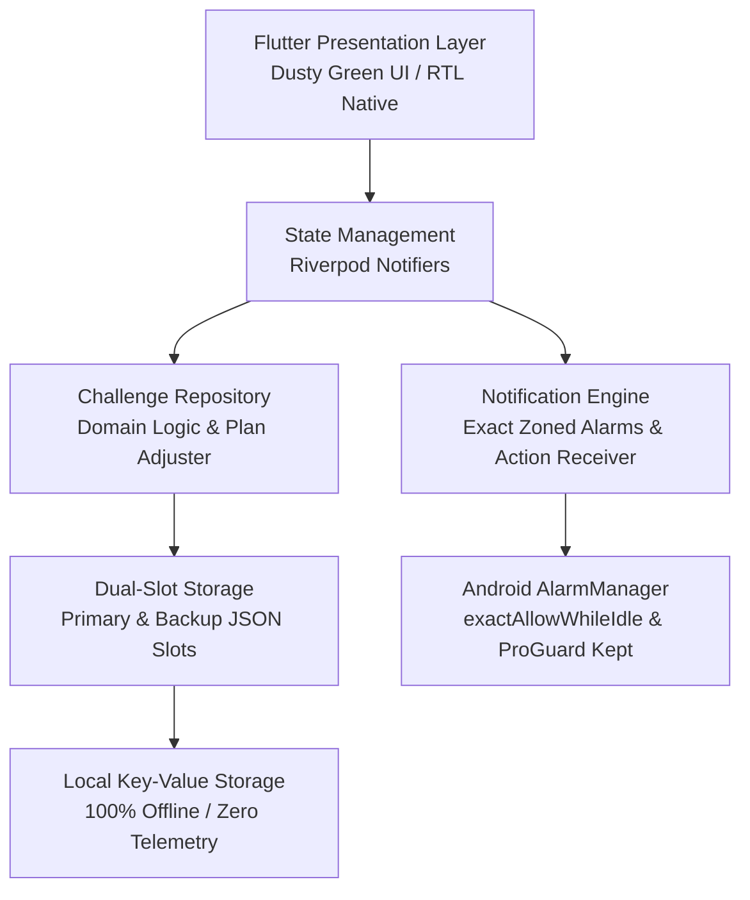

# Feature Report: 30 Juz' in 7 Days
**Comprehensive Technical & Functional Specification — Production Release**  
*Project Status: 100% Production Ready | Version: 1.0.0+1 | Last Updated: October 2026*

---

## 1. Executive Summary & Religious Foundation

**30 Juz' in 7 Days** is a focused, scholarly, offline-first mobile application designed to guide and motivate Muslims to complete a full recitation of the Qur'an (*khatmah*) over a disciplined seven-day cycle. 

The application intentionally functions as a pure **pacing, tracking, and reminder companion** rather than a heavy Qur'an reader; it contains no heavy audio recitations, tafsir libraries, or Qur'an fonts, maintaining an ultra-lightweight footprint and zero friction.

### 1.1. Prophetic Basis
The concept of completing the Qur'an within seven days is rooted in the authentic Prophetic Sunnah recorded in **Sahih al-Bukhari 5054** (and referenced in scholarly compilations including Hadith Prophet 35619):

> **Arabic Narration:**  
> «اقْرَأِ الْقُرْآنَ فِي شَهْرٍ، قُلْتُ: إِنِّي أَجِدُ قُوَّةً... قَالَ: فَاقْرَأْهُ فِي سَبْعٍ وَلاَ تَزِدْ عَلَى ذَلِكَ»  
> 
> **English Translation:**  
> *"Read the Qur'an in a month." I said: "I find in myself strength [to read more]..." The Prophet ﷺ said: "Then read it in seven days, and do not exceed that."*  
> — **Sahih al-Bukhari 5054**

### 1.2. The Traditional Seven-Part Schedule
The daily portions strictly preserve the historic division observed by the Companions of the Prophet (رضي الله عنهم) and the early generations (*Salaf*), traditionally remembered by the mnemonic **Fami Bi-Shawq (فمي بشوق)**:

$$\text{Day 1 (3 Surahs)} \longrightarrow \text{Day 2 (5 Surahs)} \longrightarrow \text{Day 3 (7 Surahs)} \longrightarrow \text{Day 4 (9 Surahs)} \longrightarrow \text{Day 5 (11 Surahs)} \longrightarrow \text{Day 6 (13 Surahs)} \longrightarrow \text{Day 7 (Al-Mufassal)}$$

---

## 2. Core Pillars & Architecture



### 2.1. Architectural Highlights
- **100% Offline & Private**: Zero external servers, zero third-party telemetry, and zero mandatory user registration. All reading progress, schedule adjustments, and alarms live strictly on the device.
- **Bilingual & RTL-Native**: Seamless real-time switching between English and Arabic (`easy_localization`). Dynamic layout mirroring, localized numerals, and authentic unvowelled Arabic Hadith text.
- **Two-Step Journey Flow**: Clean mental separation between immediate daily focus (**Step 1: "What do I do now?"**) and high-level progress review (**Step 2: "Where am I in the plan?"**), featuring a monthly heatmap and expandable cycle cards.
- **Resilient Daily Notification Engine**: Battery-optimized, high-precision Android `AlarmManager` alarms (`exactAllowWhileIdle`) scheduled at the user's custom daily time. Instant dynamic rescheduling when changing times, Android 12–14 exact alarm permission prompts, self-healing timezone detection, an interactive in-notification *"Mark as completed"* button, and automated kill switches for completed portions.
- **Dusty Green Aesthetic**: Calm, scholarly palette built with deep dusty greens (`#416757`), forest charcoal (`#1E2B25`), whisper-soft control surfaces (`#F3F7F5`), and custom mosque architectural illustrations.
- **Air-Gapped Offline Typography**: Bundled local fonts (*Amiri*, *Cormorant Garamond*, *Outfit*) with runtime network fetching completely disabled for reliable air-gapped operation.
- **Dual-Slot Storage Resilience**: Automated backup recovery slot (`active_khatmah_challenge_backup`) protecting user reading streaks from unexpected crashes or storage corruption.
- **Optimized for Telegram Distribution**: Minimized APK footprint with ProGuard / R8 code shrinking, resource optimization, WebP compression, and strict reflection keep-rules for Gson and notifications.

---

## 3. Technology Stack & Directory Structure

### 3.1. Technology Stack

| Layer | Technology | Version | Purpose |
| :--- | :--- | :--- | :--- |
| **Framework** | Flutter / Dart SDK | `^3.12.2` | High-performance cross-platform mobile engine |
| **State Management** | `flutter_riverpod` | `^2.5.1` | Reactive state management & unidirectional data flow |
| **Localization** | `easy_localization`, `intl` | `^3.0.8`, `^0.20.2` | Bilingual English/Arabic engine with live RTL switching |
| **Persistence** | `shared_preferences` | `^2.2.3` | Dual-slot resilient local key-value storage with JSON validation |
| **Notification Engine** | `flutter_local_notifications` | `^18.0.1` | Absolute zoned alarms, action broadcast receivers, notification channels |
| **Timezone Management** | `timezone`, `flutter_timezone` | `^0.10.0`, `^5.1.0` | Exact alarm scheduling with self-healing UTC offset synchronization |
| **Typography** | Local font assets (`Amiri`, `Cormorant`, `Outfit`) | Offline Bundled | Scholarly Arabic calligraphy and crisp modern UI with zero network calls |
| **Iconography & Graphics**| `flutter_launcher_icons`, Custom SVG/WebP | `^0.14.3` | Thematic launcher icons, mosque vectors, and status glyphs |
| **Build Optimization** | ProGuard / R8, Gradle Kotlin DSL | Android Gradle Plugin 8.x | Code minification, resource shrinking, and reflection preservation |

### 3.2. Project Directory Structure
```
lib/
├── core/
│   ├── constants/       # KhatmahConstants & traditional 7-part schedule table
│   ├── localization/    # LocaleKeys generator & translation helpers
│   ├── services/        # NotificationService (alarms, channels, kill switch), StorageService
│   ├── theme/           # AppColors (Dusty Green tokens), AppTheme, AppTypography
│   └── utils/           # AppDateUtils (bilingual date formatting & current day calculation)
├── features/
│   ├── challenge/       # Domain Entities, Repositories, Notifiers & Presentation
│   │   ├── data/        # ChallengeRepositoryImpl & local data source with backup recovery
│   │   ├── domain/      # Challenge & DayPortion domain entities
│   │   └── presentation/# Pages (HomePage, JourneyPage), Widgets (PortionCard, ExpandableCycleCard, etc.)
│   ├── navigation/      # MainNavigationShell (Persistent bottom navigation with RTL support)
│   ├── onboarding/      # OnboardingFlowPage (Mosque artwork, date picker, reminder setup, review)
│   └── settings/        # SettingsPage (Daily reminder picker, live countdown, bilingual language switcher)
└── main.dart            # Application entry point, localization init & background action receivers
```

---

## 4. Comprehensive Feature Breakdown

### 4.1. Onboarding & Setup Wizard
*File: [`onboarding_flow_page.dart`](file:///c:/Users/Admin/hamza/30-Juz-in-7-Days/lib/features/onboarding/presentation/pages/onboarding_flow_page.dart)*

- **Mosque Illustration Welcome**: Displays custom mosque architectural vector artwork alongside the Prophetic Hadith (*Sahih al-Bukhari 5054*) and clear introductory copy.
- **Start Date Selector**: Interactive themed calendar dialog allowing users to begin their 7-day challenge today or schedule a future start date.
- **User-Configured Reminder Time**: Prompts the user to set their preferred daily reminder time (e.g. 7:00 PM) using a native time picker.
- **Bilingual Schedule Review**: Summarizes all 7 portions with bilingual Surah ranges (Arabic/English), Surah counts, and scheduled dates.
- **Narrow-Screen Responsive Layout**: Built with flexible scrolls and compact layout guards to prevent `RenderFlex` overflows on small devices.

---

### 4.2. Main Dashboard (Home Screen)
*File: [`home_page.dart`](file:///c:/Users/Admin/hamza/30-Juz-in-7-Days/lib/features/challenge/presentation/pages/home_page.dart)*

- **Greeting & Mosque Artwork Card**: Clean header showing current cycle status with subtle mosque illustration.
- **Gentle Behind-Schedule Banner (`BehindScheduleBanner`)**:
  - Appears non-judgmentally when previous portions remain uncompleted.
  - Offers a 1-tap option to continue today as-is or open the schedule readjustment dialog.
- **Today's Portion Hero Card (`PortionCard`)**:
  - Highlights today's reading assignment with prominent bilingual Surah names (*e.g., Al-Baqarah → An-Nisa / البقرة ← النساء*).
  - Displays total Surah count and portion range.
  - **In-Place Button Transition**: Tapping *"Mark as completed"* changes the button in-place to a completed badge without adding jarring UI rows.
  - **Countdown Undo Toast**: Floating snackbar allows users to immediately undo completion if tapped accidentally.
- **Evening Rest Card**: When today's portion is completed, displays a peaceful card advising the user to rest and return tomorrow.
- **Overall Progress Overview (`OverallProgressCard`)**:
  - Visual linear progress bar filled with dusty green.
  - Percentage completed and portion fraction count (*e.g., "3 of 7 portions completed" / "٣ من ٧ أجزاء مكتملة"*).
- **Interactive 7-Day Strip (`SchedulePreviewStrip`)**:
  - Horizontal preview bar displaying status nodes for all 7 days (Completed, Today, Upcoming, Missed).
  - Tapping any node opens the Day Detail bottom inspection sheet.

---

### 4.3. Journey Screen — Two-Step Architecture
*File: [`journey_page.dart`](file:///c:/Users/Admin/hamza/30-Juz-in-7-Days/lib/features/challenge/presentation/pages/journey_page.dart)*

The Journey experience is divided into two distinct mental models:

#### Step 1: "What do I do now?" (Immediate Focus)
- Focuses exclusively on answering the user's primary daily question with maximum clarity.
- Prominent current portion card showing what to read today.
- Direct entry into the day's portion detail sheet.
- Fast access to view the full journey plan via the *"Full Plan"* card.

#### Step 2: "Where am I in the plan?" (High-Level Overview)
- **Monthly Cycle Heatmap (`MonthlyCycleHeatmap`)**:
  - Displays a calendar grid showing all completed and active reading days across the month.
  - Interactive **Month Stepper** (`<` Previous Month / Next Month `>`) with a quick "Jump to current month" button to inspect historical khatmahs and future schedules.
  - Filter pills (**All**, **Completed**, **Active**) to isolate specific reading cycles.
- **Expandable Cycle Cards (`ExpandableCycleCard`)**:
  - Groups portions by 7-day khatmah cycles.
  - Tapping expands the card downward with smooth micro-animations, revealing all 7 portions with their status badges, dates, and Surah ranges.
- **Strict Navigation Hierarchy & Back Button Handling**:
  - Opening Step 2 from Step 1: Back button returns cleanly to Step 1.
  - Opening Step 2 directly from the Home page: Back button returns cleanly to Home.
  - Switching to Home or Settings tab and returning to Journey automatically resets the view to Step 1, ensuring the user always lands on "What do I do now?".

---

### 4.4. Day Detail Inspection Sheet
*File: [`day_detail_sheet.dart`](file:///c:/Users/Admin/hamza/30-Juz-in-7-Days/lib/features/challenge/presentation/widgets/day_detail_sheet.dart)*

- **Comprehensive Metadata**:
  - English and Arabic Surah boundaries.
  - Total Surah count in the portion.
  - Scheduled date and verified completion timestamp (if completed).
  - Adjusted plan indicator badge (if rescheduled).
- **Day-Scoped Action Controls**:
  - **Today's Portion**: Displays the primary *"Mark as completed"* action button.
  - **Upcoming Portions**: Action button is disabled/hidden to prevent accidental skipping.
  - **Completed Portions**: Displays *"Completed On"* timestamp with an optional *"Undo completion"* action.

---

### 4.5. Non-Judgmental Plan Adjustment
*File: [`adjust_plan_dialog.dart`](file:///c:/Users/Admin/hamza/30-Juz-in-7-Days/lib/features/challenge/presentation/widgets/adjust_plan_dialog.dart)*

- When a user misses portions, the algorithm redistributes remaining unread Surahs across the remaining active days of the 7-day window.
- Preserves all previously completed portions without resetting total progress.
- Transparently outlines the adjusted schedule prior to user confirmation.

---

### 4.6. Production Daily Notification Engine
*File: [`notification_service.dart`](file:///c:/Users/Admin/hamza/30-Juz-in-7-Days/lib/core/services/notification_service.dart)*

- **Configurable Daily Reminder**:
  - Alarms are scheduled at the user's chosen reminder time (custom hour and minute).
  - Direct absolute-time zoned scheduling with Android `AlarmManager` (`AndroidScheduleMode.exactAllowWhileIdle`).
- **Resilient Multi-Time Triggering**:
  - When the user changes their reminder time in Settings (e.g. testing multiple times a day or adjusting preferences), previous alarms are canceled and today's uncompleted portion is scheduled immediately for the new time (if upcoming today) plus all upcoming days.
  - Eliminates flaky repeating alarms by computing deterministic, absolute daily triggers.
- **Android 12/13/14 Exact Alarm Support**:
  - Detects whether exact alarms are permitted via `canScheduleExact()`.
  - Automatically prompts the user to grant *"Alarms & Reminders"* access via `requestExactAlarmsPermission()` if needed (crucial for APKs distributed via Telegram).
  - Automatically reschedules reminders with high precision upon resuming from system settings using `WidgetsBindingObserver`.
- **Self-Healing Timezones**:
  - Synchronizes `flutter_timezone` identifier with the device's actual UTC offset (`tz.local`).
  - Automatically falls back to matching UTC offsets if the device's timezone identifier is unmapped.
- **Clean Production Channel (`khatmah_reminders_v5`)**:
  - Initialized with `Importance.max`, heads-up banner display, sound, vibration, wake-lock, and `AudioAttributesUsage.alarm`.
- **Interactive Background Notification Action**:
  - Every reminder notification includes a *"Mark as completed"* button.
  - Executes directly in a headless background isolate via `ActionBroadcastReceiver`, updates local storage, and invokes the kill switch.
- **Kill Switch**: Marking today's portion completed immediately cancels today's scheduled alarm.
- **Zero Test Buttons in UI**: Completely removed all temporary debug buttons ("Test Now", "Test in 5s") from the user-facing interface for a 100% production-ready experience.

---

### 4.7. Settings Screen
*File: [`settings_page.dart`](file:///c:/Users/Admin/hamza/30-Juz-in-7-Days/lib/features/settings/presentation/pages/settings_page.dart)*

- **Daily Reminder Controls**:
  - Toggle switch to enable or disable daily reminders.
  - Reminder time picker with localized time format.
  - **Dynamic Countdown Ticker**: Real-time tabular countdown (`Next reminder in 3h 15m` / `Due now 🔔`).
- **Bilingual Language Switcher**:
  - Instant toggle between **English** and **العربية**.
  - Immediate UI re-render and RTL layout mirroring without requiring an app restart.
- **Khatmah Management**:
  - View start date, progress summary, and an option to restart the khatmah with confirmation protection.
- **Scholarly Foundation & About**:
  - App medallion logo.
  - Authenticated Hadith reference (*Sahih al-Bukhari 5054*) in Arabic and English, detailing the Companions' 3-5-7-9-11-13-Mufassal division.

---

### 4.8. Bilingual Architecture & RTL Mirroring
*Files: `assets/translations/en.json`, `assets/translations/ar.json`, [`date_utils.dart`](file:///c:/Users/Admin/hamza/30-Juz-in-7-Days/lib/core/utils/date_utils.dart)*

- **Comprehensive Translation Coverage**: All headings, buttons, dialogs, sheet descriptions, snackbars, and countdowns are fully localized.
- **RTL Chevron & Flow Mirroring**:
  - Arrow directions automatically flip in Arabic (`chevron_left` instead of `chevron_right`, `←` instead of `→`).
  - Steppers, tabs, and schedule preview strips mirror layout orientation correctly.
- **Authentic Hadith Wording**:
  - Arabic Hadith text is formatted in clean unvowelled script (without haraka) from authentic references for effortless reading.

---

### 4.9. Design System & Brand Identity
*Files: [`app_colors.dart`](file:///c:/Users/Admin/hamza/30-Juz-in-7-Days/lib/core/theme/app_colors.dart), [`app_theme.dart`](file:///c:/Users/Admin/hamza/30-Juz-in-7-Days/lib/core/theme/app_theme.dart), [`app_typography.dart`](file:///c:/Users/Admin/hamza/30-Juz-in-7-Days/lib/core/theme/app_typography.dart)*

- **Dusty Green Color Palette**:
  - **Dusty Green (`#416757`)**: Primary brand tone, action CTAs, and completed checkmarks.
  - **Forest Charcoal / Signal Black (`#1E2B25`)**: Primary typography and dark surface elements.
  - **Control Surface (`#F3F7F5`)**: Soft sage background for cards, controls, and chips.
  - **Mist Gray (`#CDD9D3`)**: Clean borders and dividers.
  - **Terracotta (`#B85D43`)**: Muted warning and destructive action indicator.
- **Air-Gapped Offline Typography**:
  - *Amiri*: Classical Arabic calligraphy.
  - *Cormorant Garamond*: Scholarly headings and Surah names.
  - *Outfit*: Clean, modern body and UI numerals.
  - All font files are bundled directly in `assets/google_fonts/` with runtime web fetching completely disabled.

---

### 4.10. Data Persistence & Backup Recovery
*Files: [`storage_service.dart`](file:///c:/Users/Admin/hamza/30-Juz-in-7-Days/lib/core/services/storage_service.dart), [`challenge_local_data_source.dart`](file:///c:/Users/Admin/hamza/30-Juz-in-7-Days/lib/features/challenge/data/datasources/challenge_local_data_source.dart)*

- **Dual-Slot Local Backup**:
  - Primary storage slot: `active_khatmah_challenge`.
  - Secondary backup slot: `active_khatmah_challenge_backup`.
- **Automatic Recovery & Schema Validation**:
  - Validates JSON structure upon reading.
  - If the primary slot is corrupted, automatically recovers state from the backup slot without data loss.

---

### 4.11. APK Optimization for Telegram Distribution
*Files: [`build.gradle.kts`](file:///c:/Users/Admin/hamza/30-Juz-in-7-Days/android/app/build.gradle.kts), [`proguard-rules.pro`](file:///c:/Users/Admin/hamza/30-Juz-in-7-Days/android/app/proguard-rules.pro)*

- **R8 Code & Resource Shrinking**:
  - `isMinifyEnabled = true` and `isShrinkResources = true` enabled for release builds.
- **Reflection Preservation Rules**:
  - Strict keep rules in `proguard-rules.pro` protecting `com.google.gson`, `com.dexterous.flutterlocalnotifications.models.**`, and `androidx.core.app.NotificationCompat`.
- **Asset Pruning**:
  - Removed unused font weights and converted oversized images to WebP/optimized PNGs to achieve minimum download size for Telegram sharing.

---

## 5. Traditional Schedule Table Reference

| Day | Surah Range (English) | Surah Range (Arabic) | Surah Count | Scope | Traditional Block |
| :---: | :--- | :--- | :---: | :--- | :---: |
| **1** | Al-Baqarah → An-Nisa | البقرة ← النساء | 3 | Surahs 2 – 4 | 3 Surahs |
| **2** | Al-Ma'idah → At-Tawbah | المائدة ← التوبة | 5 | Surahs 5 – 9 | 5 Surahs |
| **3** | Yunus → An-Nahl | يونس ← النحل | 7 | Surahs 10 – 16 | 7 Surahs |
| **4** | Al-Isra → Al-Furqan | الإسراء ← الفرقان | 9 | Surahs 17 – 25 | 9 Surahs |
| **5** | Ash-Shu'ara → Ya-Sin | الشعراء ← يس | 11 | Surahs 26 – 36 | 11 Surahs |
| **6** | As-Saffat → Al-Hujurat | الصافات ← الحجرات | 13 | Surahs 37 – 49 | 13 Surahs |
| **7** | Qaf → An-Nas | ق ← الناس | 65 | Surahs 50 – 114 | Al-Mufassal |

---

## 6. Native Android Configuration & Notification Specifications

### 6.1. Android Manifest Permissions
```xml
<uses-permission android:name="android.permission.INTERNET"/>
<uses-permission android:name="android.permission.RECEIVE_BOOT_COMPLETED"/>
<uses-permission android:name="android.permission.POST_NOTIFICATIONS"/>
<uses-permission android:name="android.permission.SCHEDULE_EXACT_ALARM"/>
<uses-permission android:name="android.permission.USE_EXACT_ALARM"/>
<uses-permission android:name="android.permission.WAKE_LOCK"/>
<uses-permission android:name="android.permission.VIBRATE"/>
```

### 6.2. Background Receivers
- **`ScheduledNotificationReceiver`**: Dispatches exact alarms fired by Android `AlarmManager`.
- **`ScheduledNotificationBootReceiver`**: Re-registers scheduled alarms after device reboot (`BOOT_COMPLETED`, `MY_PACKAGE_REPLACED`, `QUICKBOOT_POWERON`).
- **`ActionBroadcastReceiver`**: Executes the background *"Mark as completed"* action button without launching the app UI.

### 6.3. Notification Channel Specification
- **Channel ID**: `khatmah_reminders_v5`
- **Channel Name**: `Daily Khatmah Reminders`
- **Importance**: `Importance.max` (Heads-up alert with high priority)
- **Audio Attributes**: `AudioAttributesUsage.alarm`
- **Vibration**: Enabled (`[0, 500, 250, 500]`)

---

## 7. Quality Assurance & Verification

### 7.1. Static Code Analysis
```bash
flutter analyze
Analyzing 30-Juz-in-7-Days...
No issues found! (ran in 52.3s)
```

### 7.2. Automated Test Suite
**Total: 74 automated unit and widget tests across 20 test files — 100% Passing.**

| Test File | Test Scope & Assertions | Status |
| :--- | :--- | :---: |
| `adjusted_plan_completion_test.dart` | Plan redistribution logic, completion safeguards, and UI rendering | PASS |
| `adjust_plan_test.dart` | Dynamic schedule recalculation when portions are missed | PASS |
| `challenge_logic_test.dart` | Day boundaries, JSON serialization/deserialization, and traditional schedule integrity | PASS |
| `challenge_ui_states_test.dart` | Expired challenge states, empty states, and card rendering | PASS |
| `configured_reminder_scheduling_test.dart` | Custom reminder time propagation and rescheduling upon settings update | PASS |
| `confirmation_sheet_and_toast_test.dart` | In-place button transition, confirmation bottom sheets, and countdown undo toast | PASS |
| `day_detail_sheet_test.dart` | Day-scoped button constraints and narrow-screen responsiveness | PASS |
| `demo_data_and_expandable_cycles_test.dart` | Expandable cycle cards, downward expansion animation, and month stepper | PASS |
| `glitches_and_optimization_test.dart` | Navigation back-button flows, tab switching state resets, and memory optimization | PASS |
| `icon_and_date_localization_test.dart` | Localized date formatting and chevron mirroring | PASS |
| `journey_two_step_design_test.dart` | Two-step Journey navigation ("What do I do now?" vs "Where am I in the plan?") | PASS |
| `localization_coverage_test.dart` | Translation key completeness across English and Arabic dictionaries | PASS |
| `localization_test.dart` | Live language switching without tab reload, RTL text directionality | PASS |
| `master_daily_reminder_test.dart` | Daily recurring reminder scheduling and expired challenge handling | PASS |
| `monthly_cycle_heatmap_test.dart` | Heatmap rendering, month stepper navigation, and cycle legends | PASS |
| `notification_action_test.dart` | Headless background notification action execution and storage update | PASS |
| `offline_bundled_fonts_test.dart` | Air-gapped bundled font loading with runtime network fetching disabled | PASS |
| `onboarding_overflow_test.dart` | Narrow-screen layout overflow prevention during onboarding setup | PASS |
| `settings_countdown_test.dart` | Live countdown ticker accuracy and tabular numeral formatting | PASS |
| `widget_test.dart` | Core widget bootstrapping and storage defaults | PASS |

**Test Execution Output:**
```
00:26 +74: All tests passed!
```

---

## 8. Summary & Release Readiness

The **30 Juz' in 7 Days** application is **feature-complete, robustly tested, and 100% production-ready**. 

All core capabilities—from onboarding setup, daily reading pacing, two-step journey tracking, and bilingual RTL support to resilient background notification alarms, ProGuard shrinking, and air-gapped typography—have been engineered, verified, and polished to the highest quality standards.
